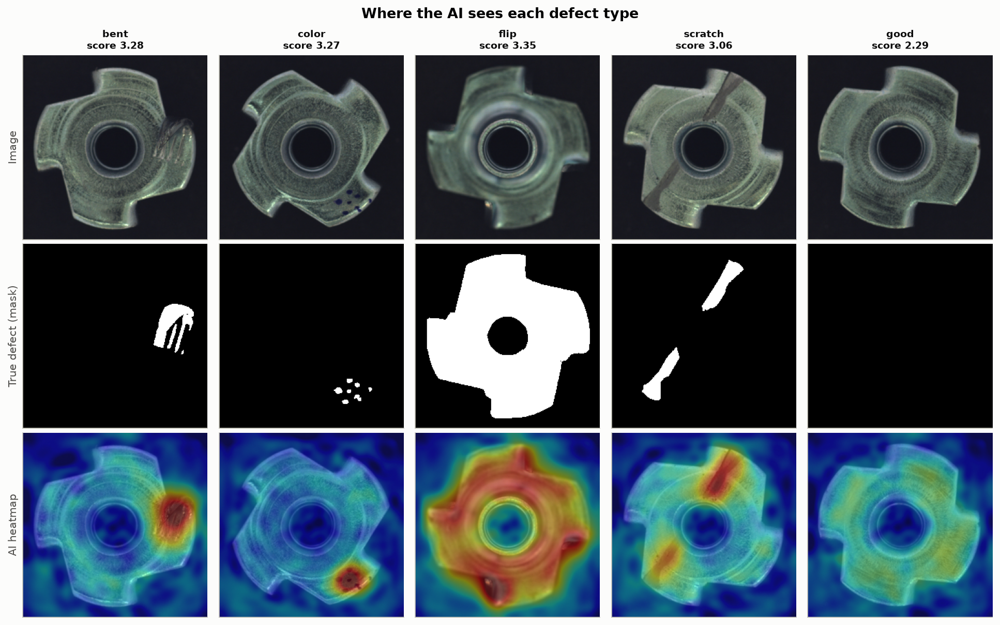
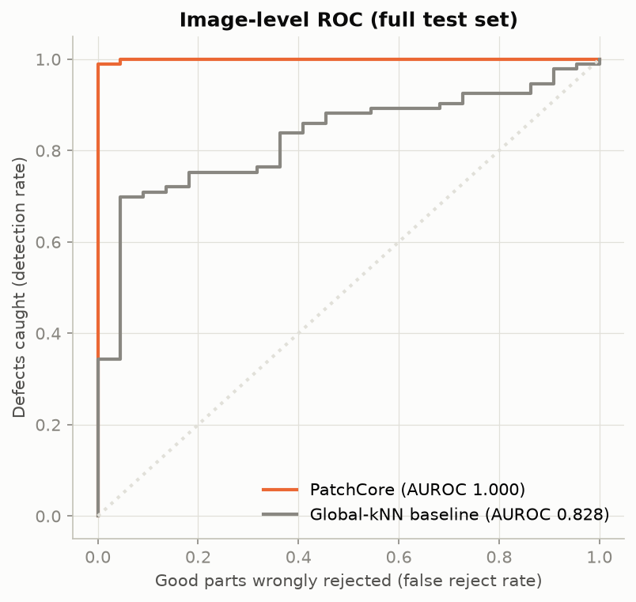

# Kaizen Visual Quality Inspection

AI visual inspection for industrial parts: finds defects on a camera image, shows **where**
they are, and lets an operator confirm or overrule the decision. Trained on **defect-free
images only**, as in a real factory, where defects are rare and unpredictable.

Built like an industry project: problem definition → AI framing → method → honest evaluation
→ explainability → human-in-the-loop review → edge deployment.



## Approach
- **PatchCore** anomaly detection (Roth et al., CVPR 2022), implemented from scratch in PyTorch:
  a pretrained Wide-ResNet-50 describes every small patch of good parts; new patches far from
  all known-good patches are anomalies.
- **Baseline:** global-kNN on whole-image features (same backbone, no patch detail).
- **Threshold chosen by business cost** (missed defect = 20, false reject = 1) on a calibration
  half of the test set; results reported on the untouched evaluation half.
- **Explainability:** pixel heatmaps for every decision, plus figures of missed defects and
  false rejects.
- **Operator review app** (Streamlit) with a decision log and overrule rate.
- **Edge:** ONNX export, correctness check and latency benchmark on GPU and CPU.

## Results
The block below is written automatically by `python -m src.pipeline`. Nothing is typed by hand.

<!-- RESULTS:START -->
## Results: `metal_nut` (generated by `python -m src.pipeline` on 2026-10-11)

| Metric | PatchCore | Global-kNN baseline |
|---|---|---|
| Image AUROC (full test set, threshold-free) | **1.000** | 0.828 |
| Pixel AUROC (does the heatmap hit the defect?) | **0.989** | not possible (no heatmap) |

**Decision threshold** chosen on the calibration half (57 images) by business cost
(missed defect = 20, good part wrongly rejected = 1).

**Evaluation half** (58 images, used once):

| | Count |
|---|---|
| Defects caught | **46 of 47** (97.9%) |
| Defects missed | 1 |
| Good parts wrongly rejected | 0 of 11 (0.0%) |
| Business cost | 20 |

| Defect type | Caught | Detection rate |
|---|---|---|
| bent | 13/13 | 100% |
| color | 11/11 | 100% |
| flip | 11/11 | 100% |
| scratch | 11/12 | 92% |

**Speed per image** (feature extraction + nearest-neighbour search, median):

| Runtime | Latency |
|---|---|
| PyTorch, CPU | 119 ms |
| ONNX Runtime, CPU | 139 ms |

ONNX export check: largest difference to PyTorch features = 5.96e-07.
Memory bank: 2,253 patches from 220 good training images.
<!-- RESULTS:END -->



## Run it (Windows, NVIDIA GPU)

**1. Environment**
```
python -m venv .venv
.venv\Scripts\activate
python -m pip install torch torchvision --index-url https://download.pytorch.org/whl/cu130
python -m pip install -r requirements.txt
python -c "import torch; print(torch.cuda.is_available(), torch.cuda.get_device_name(0))"
```
The last line should print `True` and your GPU name. (Without a GPU everything still runs on
the CPU, just slower: skip the `--index-url` part.)

**2. Data:** MVTec AD, category `metal_nut`, from
[mvtec.com/company/research/datasets/mvtec-ad](https://www.mvtec.com/company/research/datasets/mvtec-ad)
(free registration, license CC BY-NC-SA 4.0, non-commercial). Unpack it so that
`data\mvtec_ad\metal_nut\train\good\` exists:
```
mkdir data\mvtec_ad
tar -xf $HOME\Downloads\metal_nut.tar.xz -C data\mvtec_ad
```
(If you downloaded the full dataset instead of one category, unpack it the same way: it contains a `metal_nut` folder. If `tar` complains about the `.xz` format, unpack with 7-Zip instead.)

**3. Run**
```
python -m pytest                 # automated checks (no GPU or data needed)
python -m src.pipeline           # fit, evaluate, explain, export, benchmark (~5 min on a GPU)
streamlit run app/review_app.py  # operator review screen
```
Another product (PowerShell): `$env:KAIZEN_CATEGORY="bottle"` before running the pipeline.

## Project structure
```
docs/       one document per project stage
src/        data, PatchCore, baseline, evaluation, plots, ONNX export, pipeline
app/        Streamlit operator review screen
tests/      automated checks with a synthetic dataset
reports/    results.md, results.json, test scores and figures (generated)
```

## Limitations
- MVTec AD images are taken under controlled conditions; a real line needs validation with
  its own camera and lighting.
- Small test sets (about 115 images for metal_nut): detection rates have wide uncertainty.
- Anomaly detection flags *unusual*, not necessarily *defective*: a human review step is part
  of the design.
- Dataset license is non-commercial; a commercial system needs its own image data.

## References
- Bergmann et al., "MVTec AD - A Comprehensive Real-World Dataset for Unsupervised Anomaly
  Detection", CVPR 2019.
- Roth et al., "Towards Total Recall in Industrial Anomaly Detection", CVPR 2022.
